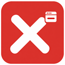

# X Ads

**โฆษณาน้อยลง เว็บสบายตาขึ้น**

X Ads คือส่วนขยายสำหรับ Google Chrome ที่ช่วยลดแบนเนอร์ โฆษณาลอย และกล่องโฆษณาบนเว็บไซต์ พร้อมปุ่มเปิด–ปิดและตัวเลือกยกเว้นเว็บไซต์ ใช้งานผ่านหน้าต่างเล็ก ๆ โทนแดง–ขาว ภาษาไทย

**รุ่นปัจจุบัน: 1.8.1** · เดิมชื่อ ClearAds

> X Ads ช่วยปิดโฆษณาได้หลายรูปแบบ แต่ยังไม่ครอบคลุมทุกเว็บไซต์และโฆษณาทุกประเภท

## X Ads ช่วยอะไรได้บ้าง

- ลดแบนเนอร์และโฆษณาลอยที่บดบังหน้าเว็บ
- ซ่อนกล่องโฆษณาบนเว็บไซต์ที่รองรับ
- ช่วยจัดการโฆษณาก่อนเล่นวิดีโอในเครื่องเล่นบางแบบ
- เปิด–ปิดการบล็อกทั้งหมดได้ในคลิกเดียว
- ยกเว้นเว็บไซต์ที่ต้องการสนับสนุน หรือเว็บไซต์ที่แสดงผลผิด
- เก็บการตั้งค่าไว้ในเครื่อง ไม่ต้องสมัครบัญชี

มีการเพิ่มการรองรับเฉพาะเว็บ เช่น Mobalytics, gg-animes, doujin-th และ 2499hdonline แล้ว อย่างไรก็ตาม แต่ละหน้าอาจมีโฆษณาต่างกัน และเว็บไซต์อาจเปลี่ยนรูปแบบโฆษณาภายหลังได้

## ก่อนติดตั้ง

ใช้ Google Chrome บนคอมพิวเตอร์ แนะนำให้อัปเดต Chrome ให้เป็นรุ่นปัจจุบันก่อน

ขณะนี้ติดตั้งโดยดาวน์โหลดไฟล์จากหน้านี้ ยังไม่มีให้ติดตั้งผ่าน Chrome Web Store หากใช้คอมพิวเตอร์ของบริษัทหรือโรงเรียน อาจมีข้อจำกัดในการติดตั้งส่วนขยาย

## วิธีติดตั้ง

1. กด **Code → Download ZIP** ด้านบนของหน้า GitHub นี้
2. แตกไฟล์ ZIP จะได้โฟลเดอร์ เช่น `adsdisable-main`
3. เปิด Chrome แล้วพิมพ์ `chrome://extensions` ในช่องที่อยู่
4. เปิด **Developer mode / โหมดนักพัฒนาซอฟต์แวร์** ที่มุมขวาบน ซึ่งจำเป็นสำหรับติดตั้งจากโฟลเดอร์
5. กด **Load unpacked / โหลดส่วนขยายที่คลายการแพ็ก**
6. เลือกโฟลเดอร์ที่แตกไว้ โดยเลือกโฟลเดอร์ที่มีไฟล์ `manifest.json` อยู่ข้างในโดยตรง
7. กดไอคอนรูปจิ๊กซอว์บนแถบเครื่องมือ Chrome แล้วปักหมุด **X Ads**
8. กลับไปยังเว็บไซต์ที่เปิดอยู่ แล้วกด **Ctrl + Shift + R** เพื่อโหลดหน้าใหม่

**เก็บโฟลเดอร์ที่เลือกติดตั้งไว้** อย่าลบหรือย้ายระหว่างใช้งาน เพราะ Chrome ยังต้องใช้ไฟล์จากโฟลเดอร์นี้

หากเคยติดตั้ง ClearAds ไว้บน Desktop สามารถใช้โฟลเดอร์เดิมได้ ชื่อที่แสดงใน Chrome เปลี่ยนเป็น X Ads แล้ว

## วิธีใช้งาน

### เปิด–ปิดการบล็อกโฆษณา

1. คลิกไอคอน **X Ads** บนแถบเครื่องมือ
2. เปลี่ยนสวิตช์ **บล็อกโฆษณา** ตามต้องการ
3. กด **รีเฟรชหน้านี้** เพื่อให้การตั้งค่ามีผลกับหน้าเว็บที่เปิดอยู่

เมื่อสวิตช์เป็นสีแดง แสดงว่าเปิดการบล็อกอยู่ เมื่อเป็นสีเทา แสดงว่าพักการบล็อก

### ยกเว้นบางเว็บไซต์

หากต้องการให้เว็บไซต์แสดงโฆษณาตามปกติ หรือพบว่าเว็บใช้งานผิดปกติ:

1. เปิดเว็บไซต์นั้น
2. คลิกไอคอน **X Ads**
3. เปิดสวิตช์ **ยกเว้นเว็บไซต์นี้**
4. กด **รีเฟรชหน้านี้**

หากต้องการกลับมาบล็อก ให้ปิดสวิตช์ยกเว้นแล้วรีเฟรชอีกครั้ง

การยกเว้นครอบคลุมเว็บย่อยด้วย เช่น ยกเว้น `example.com` จะครอบคลุม `www.example.com` ด้วย หากตัวเลือกบนเว็บย่อยเปลี่ยนไม่ได้ ให้กลับไปยกเลิกการยกเว้นที่เว็บหลัก

### ดูสถานะการทำงาน

ป้าย **ON / OFF** บนไอคอนบอกว่าเปิดหรือปิดการบล็อกโดยรวม เว็บไซต์ที่ยกเว้นอาจยังเห็นป้าย **ON** ได้ ให้ตรวจสวิตช์ **ยกเว้นเว็บไซต์นี้** เพิ่มเติม

กด **รายละเอียดการทำงาน** ในหน้าต่าง X Ads เพื่อดูเลขรุ่นและสถานะของหน้าปัจจุบัน

| ข้อความที่เห็น | ควรทำอย่างไร |
| --- | --- |
| ทำงานบนหน้านี้ พบช่องโฆษณา … จุด | การซ่อนโฆษณาเปิดทำงานอยู่ ตัวเลขเป็นตำแหน่งที่ตรวจพบ ไม่ใช่ยอดโฆษณาที่บล็อกทั้งหมด |
| ปิดอยู่หรือเว็บนี้ถูกยกเว้น | ตรวจสวิตช์บล็อกโฆษณาและสวิตช์ยกเว้นเว็บไซต์ |
| ยังไม่เชื่อมต่อหน้าเว็บ กรุณารีเฟรชหน้า | รีเฟรชหน้าเว็บ แล้วเปิด X Ads อีกครั้ง |
| หน้านี้ไม่รองรับการบล็อก | บางหน้า เช่นหน้าตั้งค่าของ Chrome ใช้ส่วนขยายไม่ได้ |

## วิธีอัปเดต

ส่วนขยายที่ติดตั้งด้วยวิธีนี้ **ยังไม่อัปเดตอัตโนมัติ** ให้ทำตามขั้นตอนเมื่อมีรุ่นใหม่:

1. ดาวน์โหลด ZIP รุ่นล่าสุดจากหน้า GitHub นี้ แล้วแตกไฟล์
2. คัดลอกไฟล์และโฟลเดอร์ข้างในไปแทนที่ในโฟลเดอร์ที่ใช้ติดตั้งเดิม
3. เปิด `chrome://extensions`
4. กดปุ่ม **↻ โหลดซ้ำ** บนการ์ด **X Ads**
5. ตรวจว่าเลขรุ่นเป็นรุ่นใหม่แล้ว
6. กลับไปหน้าเว็บ แล้วกด **Ctrl + Shift + R**

ไม่จำเป็นต้องลบส่วนขยายเดิมแล้วติดตั้งใหม่ เพียงอัปเดตไฟล์ในโฟลเดอร์เดิมและกดโหลดซ้ำ

## เมื่อใช้งานแล้วพบปัญหา

### ยังมีโฆษณาอยู่

- ตรวจว่าเปิด **บล็อกโฆษณา** และไม่ได้ยกเว้นเว็บนั้น
- หากเพิ่งติดตั้งหรืออัปเดต ให้กดโหลดซ้ำที่หน้าส่วนขยาย แล้วรีเฟรชหน้าเว็บ
- ตรวจว่าใช้รุ่นล่าสุดแล้ว
- หากยังมีอยู่ สามารถแจ้งเว็บไซต์และตำแหน่งโฆษณาได้ตามหัวข้อแจ้งปัญหาด้านล่าง

โฆษณาในวิดีโอบางแบบอาจปิดไม่ได้ โดยเฉพาะโฆษณาที่รวมอยู่ในตัววิดีโอ และยังไม่รับประกันการปิดโฆษณา YouTube หรือ Facebook

### เว็บไซต์แสดงผลผิดหรือวิดีโอไม่เล่น

เปิด **ยกเว้นเว็บไซต์นี้** แล้วรีเฟรช หากกลับมาใช้งานได้ตามปกติ ให้แจ้งปัญหาเพื่อช่วยปรับปรุงการรองรับเว็บนั้น

### หาไอคอน X Ads ไม่เจอ

กดไอคอนรูปจิ๊กซอว์ที่มุมขวาบนของ Chrome แล้วกดปักหมุดข้างชื่อ **X Ads**

### โหลดส่วนขยายไม่ได้

ตรวจว่าแตกไฟล์ ZIP แล้ว และเลือกโฟลเดอร์ที่มี `manifest.json` โดยตรง ไม่ใช่ไฟล์ ZIP หรือโฟลเดอร์ที่อยู่ชั้นนอก

## ความเป็นส่วนตัว

X Ads ไม่ต้องสมัครบัญชี ไม่เก็บประวัติการท่องเว็บ และไม่มีระบบส่งข้อมูลการใช้งานไปวิเคราะห์ภายนอก บันทึกเฉพาะสถานะเปิด–ปิดและเว็บไซต์ที่ยกเว้นไว้ในเครื่อง

Chrome อาจแจ้งว่าส่วนขยายเข้าถึงหน้าเว็บได้ สิทธิ์นี้ใช้เพื่อค้นหาและซ่อนช่องโฆษณา รวมถึงแสดงชื่อเว็บไซต์ปัจจุบันในหน้าต่าง X Ads

## วิธีถอนการติดตั้ง

1. เปิด `chrome://extensions`
2. ค้นหา **X Ads** แล้วกด **Remove / นำออก**
3. ยืนยันการนำออก

หลังถอนการติดตั้งแล้ว จึงค่อยลบโฟลเดอร์ไฟล์ส่วนขยายหากไม่ต้องการเก็บไว้

## แจ้งปัญหาหรือขอเพิ่มเว็บไซต์

แจ้งผ่าน [หน้ารายงานปัญหา](https://github.com/Sin1apachai/adsdisable/issues) พร้อมข้อมูลเหล่านี้:

- ลิงก์หน้าที่มีปัญหา
- เลขรุ่น X Ads ที่ใช้อยู่
- อธิบายว่าโฆษณาอยู่ตรงไหน หรือปรากฏหลังทำอะไร เช่นหลังคลิกเล่นวิดีโอ
- ภาพเฉพาะบริเวณที่มีปัญหา หากสะดวก

ก่อนส่งภาพ โปรดปิดข้อมูลส่วนตัวที่อาจติดอยู่ในภาพด้วย